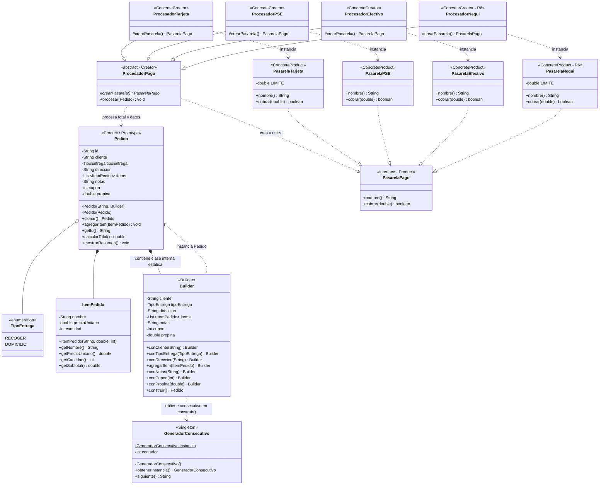

# Taller integrador: DomiExpress - Patrones Creacionales

**Integrantes:**
- Mateo Enrique Urango Morales - 20241020117
- Cristian Esteban Castañeda Vargas - 20241020094
- Santiago Nicolás Triana Mariño - 20241020115

---

## 1. Problemas identificados en el código inicial (sin patrones)

En el fragmento original de la Sección 3 del enunciado se evidencian tres problemas graves de diseño:

1. **Contador suelto y repetido (`private static int contador = 0`):** No existe un único punto de control ni encapsulamiento para la generación de identificadores consecutivos. Si múltiples clases manejan contadores independientes o si se instancian pedidos fallidos, se desperdician consecutivos o se generan colisiones de IDs, violando el principio de responsabilidad única.
2. **Constructor telescópico y confuso (`new Pedido(...)` con 8 parámetros):** Parámetros booleanos, cadenas vacías y enteros mágicos sin etiqueta (`"DOMICILIO", "Cra 7 # 45-10", items, "", 10, 3000`) provocan código poco legible, propenso a errores de orden al invocar y rígido ante cambios en los requerimientos o al incorporar nuevos atributos opcionales.
3. **Control de flujo rígido mediante cadenas y condicionales (`if/else if` sobre `medioPago`):** El procesamiento de pago viola el principio Abierto/Cerrado (OCP). Agregar un nuevo medio de pago (como Nequi) obliga a modificar la clase existente añadiendo más ramas condicionales, aumentando el acoplamiento y el riesgo de regresiones.

---

## 2. Justificación de los patrones utilizados

### 2.1 Singleton (`GeneradorConsecutivo`)
- **Problema que resuelve:** Resuelve el descontrol del contador suelto garantizando una **única fuente de verdad** para numerar pedidos con el formato estricto `PED-0001`, `PED-0002`, etc. Al centralizar la secuencia en una única instancia con constructor privado y método `obtenerInstancia()`, se asegura que ningún pedido duplicará un identificador y, al ser invocado exclusivamente al final de la construcción exitosa, ningún pedido rechazado consumirá un consecutivo.
- **Cuándo NO usarlo:** No debe usarse si se requiere soportar múltiples secuencias independientes en paralelo (por ejemplo, numeraciones por sucursal o por tipo de factura), en arquitecturas distribuidas de alta concurrencia donde un Singleton en memoria generaría un cuello de botella o problemas de sincronización entre nodos, o en sistemas con inyección de dependencias donde un ciclo de vida gestionado por el contenedor resulta más testeable y desacoplado.

### 2.2 Builder (`Pedido.Builder`)
- **Problema que resuelve:** Resuelve la complejidad del constructor telescópico de 8 parámetros. Permite construir pedidos paso a paso con una API fluida y legible (`conCliente`, `conTipoEntrega`, etc.), asignando valores por defecto seguros (por ejemplo, `TipoEntrega.RECOGER`, cupón en 0) y encapsulando las validaciones de negocio en el método `construir()` con los mensajes de excepción y orden requeridos antes de instanciar el objeto inmutable.
- **Cuándo NO usarlo:** No debe usarse para objetos simples que tienen pocos atributos (2 o 3), todos obligatorios e inmutables, o donde no existan combinaciones de datos opcionales ni validaciones cruzadas complejas. En tales casos, un constructor convencional o un método de fábrica estático es mucho más simple y evita el sobrecosto de crear una clase interna y un objeto intermedio.

### 2.3 Factory Method (`ProcesadorPago` y subclases)
- **Problema que resuelve:** Resuelve el encadenamiento de `if / else if` y desacopla la lógica de procesamiento común de la creación específica de la pasarela de pago. La clase base `ProcesadorPago` define la plantilla del flujo (`procesar(Pedido)`) exactamente una vez (crear, mostrar cobro, cobrar, mostrar resultado), mientras delega la instanciación de cada `PasarelaPago` a sus subclases concretas (`ProcesadorTarjeta`, `ProcesadorPSE`, `ProcesadorEfectivo`, `ProcesadorNequi`), cumpliendo a cabalidad con el principio Abierto/Cerrado (OCP).
- **Cuándo NO usarlo:** No debe usarse si el sistema solo soporta y soportará de manera definitiva un único medio de pago sin variación algorítmica ni necesidad de polimorfismo, o si la familia de pasarelas no comparte un flujo de procesamiento uniforme, en cuyo caso introducir la jerarquía de creadores generaría sobreingeniería y clases innecesarias.

### 2.4 Prototype (`Pedido.clonar()`, Reto extra)
- **Problema que resuelve:** Permite duplicar pedidos previos ("Repetir mi último pedido") de forma eficiente y desacoplada del proceso de construcción manual. Garantiza una copia profunda de la colección de ítems para que modificaciones posteriores en el clon no afecten el pedido original, asigna un nuevo identificador consecutivo mediante el Singleton y reinicia el cupón de descuento a 0% por regla de negocio de cupones de un solo uso.
- **Cuándo NO usarlo:** No debe usarse cuando los objetos contienen referencias a recursos externos irreproducibles (como sockets de red, conexiones a bases de datos o hilos de ejecución activos), cuando la estructura de grafos de objetos con referencias circulares hace que el clonado profundo sea excesivamente complejo y propenso a fugas de memoria, o cuando la creación de un nuevo objeto desde cero es trivial y no requiere copiar estado existente.

---

## 3. Diagrama de clases



---

## 4. Evidencia de ejecución

### 4.1 Salida de `App.java`
```text
=== 1. Singleton: consecutivo unico ===
[Consecutivo] Instancia creada.
g1 y g2 son el mismo objeto: true

=== 2. Builder: construccion de pedidos ===
Pedido PED-0001 | Cliente: Ana Torres | Entrega: DOMICILIO (Cra 7 # 45-10, Bogota)
  - 1 x Bandeja paisa ($28000)
  - 2 x Limonada ($6000)
  Cupon: 10% | Propina: $3000 | Total: $39000
Pedido PED-0002 | Cliente: Luis Perez | Entrega: RECOGER
  - 4 x Empanada ($3500)
  Notas: Sin aji
  Cupon: 0% | Propina: $0 | Total: $14000
Pedido rechazado: El pedido debe tener al menos un item
Pedido rechazado: El domicilio requiere direccion
Pedido PED-0003 | Cliente: Empresa Andina | Entrega: RECOGER
  - 20 x Combo familiar ($30000)
  Cupon: 0% | Propina: $0 | Total: $600000

=== 3. Factory Method: medios de pago ===
Procesando PED-0001 con Tarjeta por $39000
  -> Pago APROBADO
Procesando PED-0002 con Efectivo por $14000
  -> Pago APROBADO
Procesando PED-0003 con Tarjeta por $600000
  -> Pago RECHAZADO
Procesando PED-0003 con PSE por $600000
  -> Pago APROBADO

=== 4. Extension sin modificar codigo existente ===
Procesando PED-0002 con Nequi por $14000
  -> Pago APROBADO
Procesando PED-0003 con Nequi por $600000
  -> Pago RECHAZADO
```

### 4.2 Salida de `AppBonus.java`
```text
=== Reto extra: Prototype (repetir pedido) ===
[Consecutivo] Instancia creada.
-- Original --
Pedido PED-0001 | Cliente: Ana Torres | Entrega: DOMICILIO (Cra 7 # 45-10, Bogota)
  - 1 x Bandeja paisa ($28000)
  Cupon: 10% | Propina: $3000 | Total: $28200
-- Repetido (copia con un item extra) --
Pedido PED-0002 | Cliente: Ana Torres | Entrega: DOMICILIO (Cra 7 # 45-10, Bogota)
  - 1 x Bandeja paisa ($28000)
  - 1 x Postre ($8000)
  Cupon: 0% | Propina: $3000 | Total: $39000
```